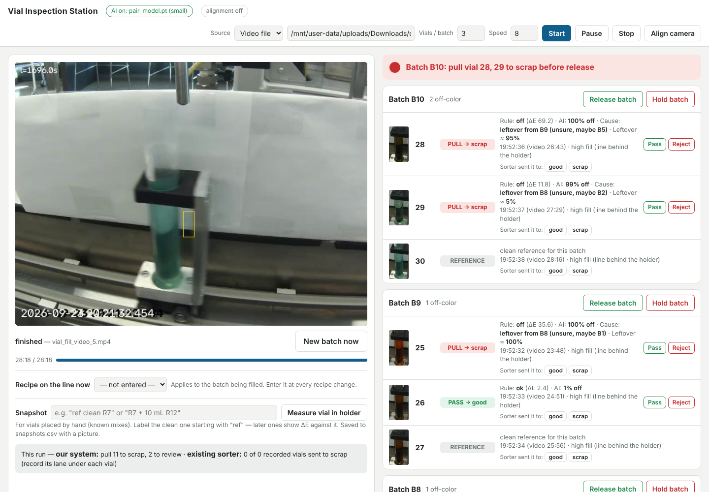
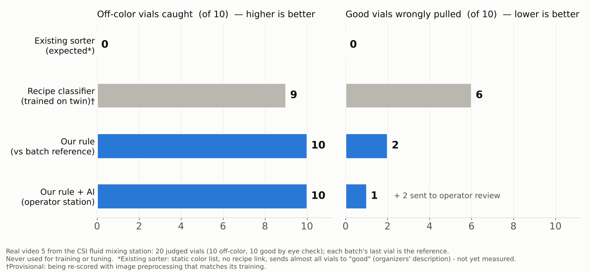

# Melting Rainbow — recipe-aware off-color detection for the CSI fluid mixing station

**Team Melting Rainbow (UWM):** Cruz Rios · Frank Hejl · Junyan He
**Hackathon:** Rockwell Automation + NVIDIA Physical AI Hackathon, Fall 2026 — Dataset 2, Fluid Mixing Station

> **Judges, start here.** 1-minute summary below → [Results](docs/RESULTS.md) (every number with its source) → [How it works](docs/HOW_IT_WORKS.md) → [Runbook](RUNBOOK.md) (run it yourself on the CSI computer or any laptop).

---

## The problem

When the mixing station changes recipes, liquid left in the lines tints the first vials of the new batch (**carryover**).
The line's existing color check compares each vial against a **static color list** that can't be updated and has **no link to the recipe**, so it sends almost every vial to the "good" location. Off-color vials from a changeover ship as good product.

## Our solution

An **operator station** (browser page, runs on the line's PC with its fill camera) that:

1. **Finds every fill** from the camera — including clear and pale liquids.
2. **Compares each vial with its own batch's clean reference vial** (the batch's last vial), measured against the white backdrop. It **never needs to know what color a recipe should be** — no color database, so new recipes and new dyes work on day one.
3. Gets a **second opinion from an AI model trained only on digital-twin images** (Isaac Sim), which looks only at the *difference* between the two vials.
4. Tells the operator **PASS → good**, **PULL → scrap** (with the likely cause: *"leftover from batch 8"*, and the leftover %), or **REVIEW** when rule and AI disagree.
5. Logs every vial, decision and raw camera frame — ready for PLC integration after the hackathon.

## Results (organizers' labeled video 5 — never used for training or tuning)

| Method | Off-color vials caught | Good vials wrongly pulled | Cause named right |
|---|---|---|---|
| Existing color check (static list, no recipe link) | ~0 / 10 expected* | ~0 / 10 | — |
| **Our rule** (vs. batch's clean vial, ΔE ≥ 7) | **10 / 10** | 2 / 10 | 6 / 10 |
| **Our twin-trained AI** (difference-only) | **10 / 10** | 1 / 10 | — |
| **Rule + AI = operator station** | **10 / 10** | **1 / 10** + 2 sent to operator review | 6 / 10 |

\*Organizers' description of the existing system (the line shows no per-vial decision to record).
Digital-twin test (train on 9 recipes, test on the unseen 10th, 2,000 images): AI misses 8 %, false-alarms 5 %.
Full details, where each number comes from, and scope / next steps: [docs/RESULTS.md](docs/RESULTS.md).

**On the real CSI line (Oct 28):** the station ran live on the CSI computer with the line's own vial-fill camera, through recipe changes (dark orange → light blue → dark orange → dark blue). Results from that run: *[being processed — will be added here]*.

## Run it

- **On the CSI computer:** `./start_capture.sh` (opens the page at `localhost:8765`) — full steps in [RUNBOOK.md](RUNBOOK.md).
- **On any laptop with a recorded video:** see "Run on a recorded video" in the runbook. Needs Python 3.10+, `opencv-python`, `numpy` (and `torch` for the AI second opinion).

## What's in this repo

| Folder / file | What it is |
|---|---|
| [`RUNBOOK.md`](RUNBOOK.md) | Step-by-step: set up and run the station on the CSI computer |
| [`docs/`](docs) | [Results](docs/RESULTS.md), [How it works](docs/HOW_IT_WORKS.md), figures, result CSVs, [event info](docs/EVENT_INFO.md) |
| [`melting-rainbow/operator_ui/`](melting-rainbow/operator_ui) | **The operator station** (web page + engine) and the trained AI model (`pair_model.pt`, 79 KB) |
| [`melting-rainbow/demo/`](melting-rainbow/demo) | Command-line version of the inspection (writes an annotated video) |
| [`melting-rainbow/lane2_color/`](melting-rainbow/lane2_color) | Fill detection (finds each vial and its fill level) |
| [`melting-rainbow/common/`](melting-rainbow/common) | How a vial's color is measured (liquid ÷ white paper) |
| [`melting-rainbow/lane6_classifier/`](melting-rainbow/lane6_classifier) | The rule, the AI comparison model (training + tests), video 5 scoring |
| [`melting-rainbow/lane4_twin/`](melting-rainbow/lane4_twin) | Isaac Sim digital twin: renders the 2,000 training images |
| [`start_capture.sh`](start_capture.sh) | One-command start on the CSI computer (set up with CSI staff) |
| [`windows/`](windows) | Double-click launchers for Windows; `isaac_twin/` = twin rendering launchers |
| [`frank_recipe_classifier/`](frank_recipe_classifier) | Frank's EfficientNet recipe classifier — the first AI we tried (see why we changed approach in [How it works](docs/HOW_IT_WORKS.md#what-we-tried-first)) |
| [`archive/`](archive) | Early experiments not used by the final system (kept for history) |

## Data

Not stored in this repo (too large): the organizers' dataset (`csi-vial-fill-dataset`, from the event guide), our 2,000-image twin dataset and raw camera recordings — on the team Google Drive. The station writes its outputs to `results/` (git-ignored).

## Credits and references

- **Frank Hejl:** EfficientNet recipe classifier and comparison experiments, trained on the DGX Spark ([`frank_recipe_classifier/`](frank_recipe_classifier)).
- **CSI staff** for line time and for setting up the vial-fill camera on the CSI computer.
- **Data:** organizers' CSI fluid mixing dataset (videos 1–5, video 5 labels) and digital twin (`csi_digital_twin_v1`).
- **Tools:** NVIDIA Isaac Sim 6.0 (twin rendering), PyTorch, timm (EfficientNet-B0), OpenCV, NumPy. AI coding assistants (Claude, Codex) helped write and test code; every result here was re-run from this repo.
- Event: Rockwell Automation · NVIDIA · MSOE AI Club · UWM Connected Systems Institute — [event info](docs/EVENT_INFO.md).
