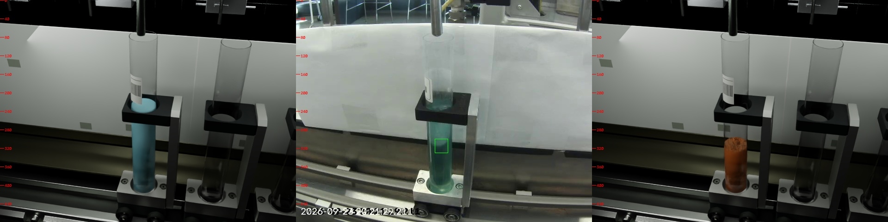
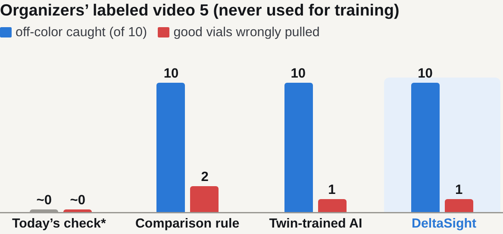
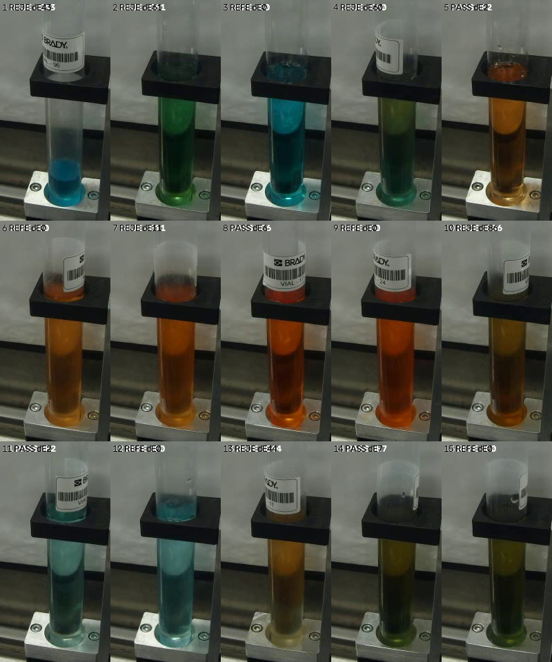

# DeltaSight — catches carryover, names the source

**Project Melting Rainbow · Team AI_Caramba:** Cruz Rios · Frank Hejl · Junyan He 
**Hackathon:** Rockwell Automation + NVIDIA Physical AI Hackathon, Fall 2026 — Dataset 2, Fluid Mixing Station

> **Judges, start here.** [5-minute video](https://drive.google.com/file/d/1jlSOK7QajEO4K2JgmwMbThvXs7yhk1js/view) · [one-page summary](https://drive.google.com/file/d/1OoVyOhrAtTa1DL5qyle_2kAzHqmkOitr/view) · 1-minute summary below → [Results](docs/RESULTS.md) (every number with its source) → [How it works](docs/HOW_IT_WORKS.md) → [Runbook](RUNBOOK.md) (run it yourself on the CSI computer or any laptop).

---

## The problem

After a recipe change, liquid left in the lines **tints the first vials** of the next recipe (**carryover**). Today's sorter matches color against a **static database** with no link to the running recipe, so a tinted vial can still pass, hurting safety, quality, delivery and cost on any liquid line with changeovers.

| Safety | Quality | Delivery | Cost |
|---|---|---|---|
| A wrong mix can reach the customer | Off-spec product ships: complaints and returns | Rework and longer changeovers slow the line | Scrap, plus oversized purges "just to be safe" |

**Where else it fits:** any line that changes color or recipe — liquid pharma (a fast check of the first vials after cleaning between products), cosmetics (shade consistency), paint and coatings (tint changeovers), beverages (flavor and syrup changeovers), chemicals (dye and dosing lines). Same setup everywhere: one camera, a white backdrop, no recipe list.

## Our solution

**DeltaSight** runs as an operator station (a browser page on the line's PC, using its fill camera). It is **never told the recipe or its color**; its only setting is "every 3 vials is one recipe". It:

1. **Finds every fill** from the camera — including clear and pale liquids.
2. **Compares each vial with the most recent vial of the same recipe** (the last vial of its recipe group, the cleanest one), measured against the white backdrop. It **never needs to know what color a recipe should be** — no color database, so new recipes and new dyes work on day one.
3. Gets a **second opinion from an AI model trained only on digital-twin images** (Isaac Sim), which looks only at the *difference* between the two vials.
4. Tells the operator **PASS → good**, **PULL → scrap** (with the likely cause: *"leftover from B8"*, and the leftover %), or **REVIEW** when rule and AI disagree.
5. Logs every vial, decision and raw camera frame. **Every operator Pass / Reject click becomes a labeled real example** to retrain on (the operator flywheel: the station gets better with use).

**How we got here — four ideas, one that works:** (1) predict each recipe's color: needs a color database; (2) AI recognizes the recipe: 82 % on twin, ~25 % on real video; (3) AI compares absolute colors: 92 % false alarms on new recipes; (4) **DeltaSight: compare with the most recent vial of the same recipe, difference only** — works on real video and live. Lesson: compare, don't memorize. Details: [How it works](docs/HOW_IT_WORKS.md#what-we-tried-first).

## Physical AI: the digital twin as our camera lab

We used the station's digital twin in **NVIDIA Isaac Sim** as a camera lab: we lined it up with the real camera, matched its exposure and found where to measure (the white paper, rebuilt at its real height), and set our cutoffs before we had line time. Then we trained an AI on 2,000 rendered vials to judge **differences, not colors**, since simulated colors never match a real camera. On recipes it never saw: **8 % missed, 5 % false alarms**.

## Results (organizers' labeled video 5 — never used for training or tuning)

| Method | Off-color vials caught | Good vials wrongly pulled | Cause named right |
|---|---|---|---|
| Today's check* (static color list, no recipe link) | ~0 / 10 | ~0 / 10 | — |
| **Comparison rule** (vs. the most recent vial of the same recipe, ΔE ≥ 7) | **10 / 10** | 2 / 10 | 6 / 10 |
| **Twin-trained AI** (same pair, difference only) | **10 / 10** | 1 / 10 | — |
| **DeltaSight = rule + AI** (agree → PULL; disagree → REVIEW) | **10 / 10** | **1 / 10** + 2 sent to REVIEW | 6 / 10 |

\*Organizers' description of the existing check (the line shows no per-vial decision to record). 20 judged vials (10 off-color, 10 good), scored once.
Full details, where each number comes from, and scope / next steps: [docs/RESULTS.md](docs/RESULTS.md).

## Live on the CSI line (Oct 28 and Oct 30)

We ran DeltaSight live on the CSI line twice, using the line's own fill camera and computer: **Oct 28** (26 vials, 5 recipe changes) and **Oct 30** (15 vials, 5 recipes, fully recipe-blind). It recorded every run to USB and logged every operator decision.

- **Oct 30:** the first vial after every recipe change was pulled (**4 of 4 recipe changes caught**) and the vial after it passed (4 of 4, one via REVIEW). **3 of 4** causes named right. Every fill found (15/15). Live truth = our check of the camera frames; a blind by-eye poll agreed on all 9 Oct 30 pairs (early responses).
- **Oct 28:** **4 of 5** changes caught (one possible miss, blue → green). Replaying the raw video through today's code gives the same call on **26 of 26** vials.
- **Rejection rate:** 34 % in testing (recipe changed every 3 vials) ≈ **1 vial per changeover** in longer runs, because live only the first vial after a change was pulled.

Details and per-vial files: [docs/RESULTS.md](docs/RESULTS.md#4-live-on-the-csi-line).

## Cost to set up

| Setup | Cost | What it is |
|---|---|---|
| What we ran | **$0** | The CSI line's own camera and computer, a sheet of white paper, free software |
| Starter kit | **under $100** | ~$40 USB webcam + ~$20 mount on any laptop; **no GPU** (the AI model is 79 KB) |
| Optional 24/7 kit | ≈ $1,800 | NVIDIA Jetson Orin Nano Super, Basler camera + lens, backlight, mount |

Prices checked Oct 31, 2026 (BetaNews, hwbusters.com, machinevisionstore.com, va-imaging.com); mounts are our estimates.

## What it could save

About 1 off-color vial per changeover ships today; DeltaSight caught 10 of 10 (today's check: ~0). So **changeovers per year ≈ off-color units stopped** — e.g. 5 a day × 250 days ≈ 1,250 per line per year (illustrative: plug in your own line).

| Every plant | Catch it early | Food & beverage |
|---|---|---|
| **25 %+** of sales can go to quality costs, actual plus hidden ([ASQ](https://asq.org/training/cost-of-quality---finance-for-continuous-improvement-qpc)) | **10×** cheaper to catch a defect in the plant than after it ships ([NSF International, 2017](https://www.nsf.org/knowledge-library/white-paper-what-does-poor-quality-cost)) | **$10M** average direct cost of one recall: the price of 100,000 starter kits ([FMI + GMA via Food Dive](https://www.fooddive.com/news/more-than-money-what-a-recall-truly-costs/426855/)) |

## What's next: PLC integration

The PLC communicates the production queue:
- **Batch size per recipe:** DeltaSight adjusts automatically (today it's set by hand: "every 3 vials").
- **Recipe queue:** DeltaSight learns each recipe's colors and estimates new recipes' colors.
- **PULL → diverter:** the line rejects the vial automatically.

Also next: the most consistent recent vial as the reference; check the leftover % against mixes made on purpose; a second camera angle for full vials; a data upload kit so every run becomes training data (CSI staff feedback).

## Run it

- **On the CSI computer:** `./start_capture.sh` (opens the page at `localhost:8765`) — full steps in [RUNBOOK.md](RUNBOOK.md).
- **On any laptop with a recorded video:** see "Run on a recorded video" in the runbook. Needs Python 3.10+, `opencv-python`, `numpy` (and `torch` for the AI second opinion).

## What's in this repo

| Folder / file | What it is |
|---|---|
| [`RUNBOOK.md`](RUNBOOK.md) | Step-by-step: set up and run the station on the CSI computer |
| [`docs/`](docs) | [Results](docs/RESULTS.md), [How it works](docs/HOW_IT_WORKS.md), figures, result CSVs, [event info](docs/EVENT_INFO.md) |
| [`melting-rainbow/operator_ui/`](melting-rainbow/operator_ui) | **The operator station** (web page + engine) and the trained AI model (`pair_model.pt`, 79 KB) |
| [`melting-rainbow/demo/`](melting-rainbow/demo) | Command-line version of the inspection (writes an annotated video) |
| [`melting-rainbow/lane2_color/`](melting-rainbow/lane2_color) | Fill detection (finds each vial and its fill level) |
| [`melting-rainbow/common/`](melting-rainbow/common) | How a vial's color is measured (liquid ÷ white paper) |
| [`melting-rainbow/lane6_classifier/`](melting-rainbow/lane6_classifier) | The rule, the AI comparison model (training + tests), video 5 scoring |
| [`melting-rainbow/lane4_twin/`](melting-rainbow/lane4_twin) | Isaac Sim digital twin: renders the 2,000 training images |
| [`start_capture.sh`](start_capture.sh) | One-command start on the CSI computer (set up with CSI staff) |
| [`windows/`](windows) | Double-click launchers for Windows; `isaac_twin/` = twin rendering launchers |
| [`frank_recipe_classifier/`](frank_recipe_classifier) | EfficientNet recipe classifier (trained on Rosie, MSOE's supercomputer) — the first AI we tried (see why we changed approach in [How it works](docs/HOW_IT_WORKS.md#what-we-tried-first)) |
| [`archive/`](archive) | Early experiments not used by the final system (kept for history) |

## Data

Not stored in this repo (too large): the organizers' dataset (`csi-vial-fill-dataset`, from the event guide), our 2,000-image twin dataset and raw camera recordings — on the team Google Drive. The station writes its outputs to `results/` (git-ignored).

## Credits and references

- **CSI staff:** line time, camera setup on the CSI computer, and feedback.
- **Data:** organizers' CSI fluid mixing dataset (videos 1–5, video 5 labels) and digital twin (`csi_digital_twin_v1`); our live CSI runs on Oct 28 and Oct 30.
- **AI, tools and compute:** Claude (Anthropic) was our primary coding and AI assistant; Codex (in VS Code on the CSI lab computer) connected our program to the CSI line; every result here was re-run from this repo. NVIDIA Brev credits ran the Isaac Sim renders; the EfficientNet experiments were trained on Rosie, MSOE's supercomputer ([`frank_recipe_classifier/`](frank_recipe_classifier)). NVIDIA Isaac Sim 6.0, PyTorch, timm (EfficientNet-B0), OpenCV, NumPy, ffmpeg.
- **Costs and savings sources:** [ASQ, Cost of Quality](https://asq.org/training/cost-of-quality---finance-for-continuous-improvement-qpc) (quality costs often 25 %+ of sales); [NSF International, *What Does Poor Quality Cost?* (2017)](https://www.nsf.org/knowledge-library/white-paper-what-does-poor-quality-cost) (10× rule); [FMI + GMA recall study via Food Dive](https://www.fooddive.com/news/more-than-money-what-a-recall-truly-costs/426855/) ($10M average direct cost per recall).
- **Event:** Rockwell Automation · NVIDIA · MSOE AI Club · Connected Systems Institute — [event info](docs/EVENT_INFO.md).
