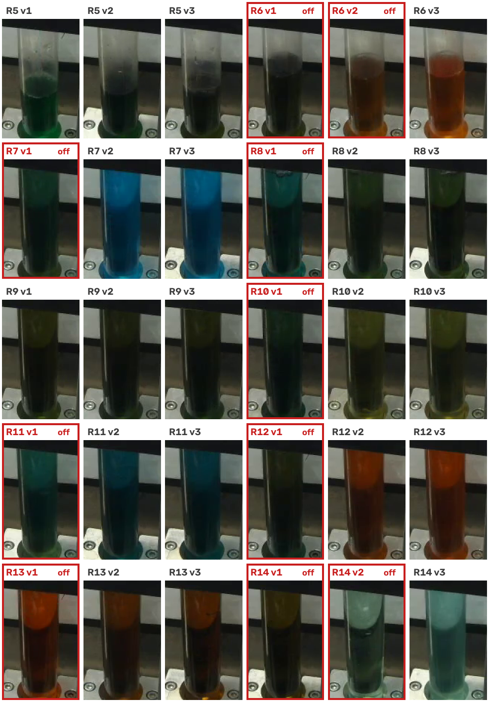
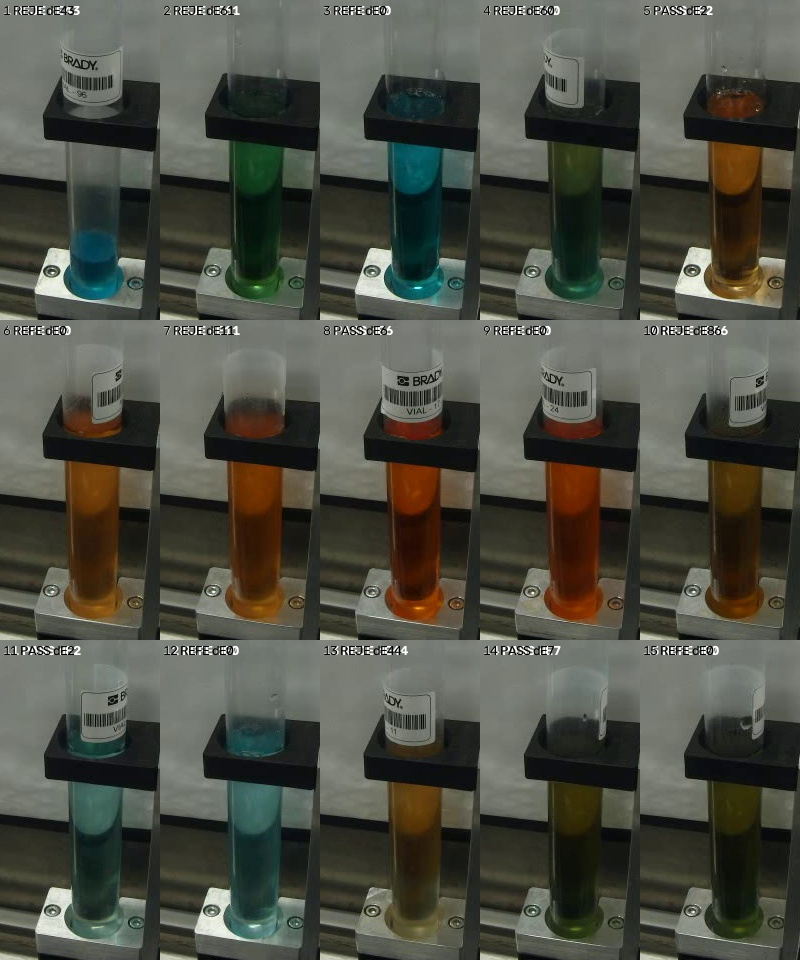
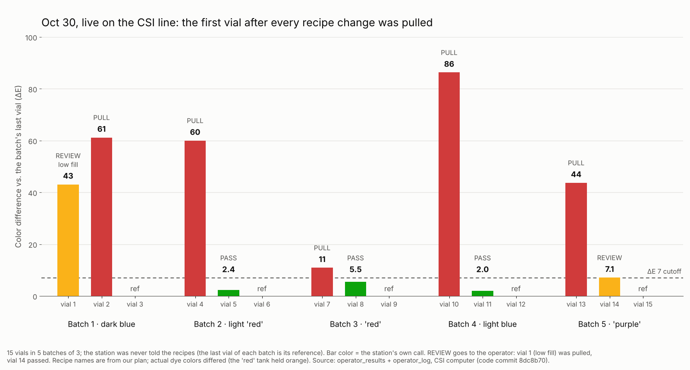

# Results — every number and where it comes from

All result files referenced here are in [`docs/results/`](results). Commands re-create them from this repo plus the organizers' dataset.

## 1. Validation on real video 5 (the organizers' only labeled video)

**Setup.** 30 vials, filled in recipe groups of 3; each group's **most recent (last) vial is its reference**, so 20 vials are judged: **10 off-color, 10 good** (eye check, [`melting-rainbow/labels/truth_by_eye.csv`](../melting-rainbow/labels/truth_by_eye.csv)). Video 5 was **never used for training or tuning**; each model version was scored on it once.



| Method | Off-color caught (of 10) | Good wrongly pulled (of 10) | Cause named right | Source |
|---|---|---|---|---|
| Today's check | ~0 | ~0 | — | Organizers' description of the existing check (not measurable: the line shows no per-vial decision) |
| Comparison rule (vs. the most recent vial of the same recipe, ΔE ≥ 7) | **10** | 2 | 6 of 10 | [`rule_video5.csv`](results/rule_video5.csv) |
| Twin-trained AI (same pair, difference only) | **10** | 1 | — | [`pair_model_video5_relative.csv`](results/pair_model_video5_relative.csv) |
| **DeltaSight = rule + AI** | **10** PULL | **1** PULL + 2 REVIEW | 6 of 10 | [`operator_station_video5.csv`](results/operator_station_video5.csv) |

Re-create:
```
python melting-rainbow/lane6_classifier/eval_video5.py <dataset>/csi-vial-fill-dataset melting-rainbow/labels/truth_by_eye.csv
python melting-rainbow/operator_ui/operator_app.py --video <dataset>/.../vial_fill_video_5.mp4 --autostart --speed 200 --ai-model melting-rainbow/operator_ui/pair_model.pt
```

**The misses and false alarms, explained**
- Vial 1 (the one good vial pulled): the organizers' recording starts mid-session, so the station had no earlier recipe group to compare its first group with. In a live run the operator now measures one clean vial of the previous recipe at the start ("prev" vial, added Oct 28), so the first group is checked and its cause named like every other group (tested on video 5 frames: vials 4–5 → "R5", leftover 78 % / 49 %).
- Vials 2 and 13 (REVIEW): rule and AI disagreed; both truly good. The operator decides.
- Cause wrong for 4 of 10: when several earlier recipes have similar colors, the leftover's source is ambiguous; the page marks these "unsure, maybe B2".

## 2. Digital-twin test (generalization to unseen recipes)

2,000 Isaac Sim renders (every recipe, and every recipe-to-recipe leftover from 5 % to 100 %), camera exposure calibrated to the real camera. **Leave-one-recipe-out**: train on 9 recipes, test on the 10th, repeat for all 10.

| AI model | Misses | False alarms | Source |
|---|---|---|---|
| **Twin-trained AI (difference only, used)** | **89 / 1,090 (8 %)** | **48 / 910 (5 %)** | [`pair_model_loro_relative.csv`](results/pair_model_loro_relative.csv) |
| EfficientNet comparison that could see absolute color | 191 / 1,090 (18 %) | 840 / 910 (92 %) | Oct 26 EfficientNet run on Rosie (MSOE's supercomputer) |

Lesson: a model trained on simulation must **compare**, not memorize simulated colors (twin vs. real colors differ by ΔE 16–52 even after calibration).

## 3. Finding the vials (fill detection) on all organizers' videos

| Video | Vials (organizers' list) | Found |
|---|---|---|
| 1 | 19 | 19 |
| 2 | 3 | 3 |
| 3 | 6 | **6** (the older color-based detector found 3 — it missed pale/clear fills) |
| 4 | 6 | 6 |
| 5 | 30 | 30 (start/end within ~1–5 s of the organizers' labels) |

## 4. Live on the CSI line

Both runs used the line's own vial-fill USB camera (640×480, white balance locked) and the CSI computer. The station was **never told the recipes or their colors**, only "every 3 vials is one recipe group". Truth for the live runs is our check of the camera frames; there was no independent by-eye label on the day.

### Oct 30: main run, fully recipe-blind ([`oct30_live_per_vial.csv`](results/oct30_live_per_vial.csv))



| | |
|---|---|
| What ran | **15 vials = 5 recipe groups of 3** (code commit `8dc8b70`) |
| Fills found | **15 of 15** (replaying the raw video gives the identical 15) |
| Station's calls | 5 PULL (vials 2, 4, 7, 10, 13), 2 REVIEW (vial 1: fill too low to read; vial 14: rule and AI disagreed), 3 PASS, 5 references |
| **Headline** | **The first vial after every recipe change (vials 4, 7, 10, 13) was pulled: 4 of 4. The vial after it passed: 4 of 4** (vial 14 via REVIEW, passed by the operator) |
| ΔE of the catches | vial 10: 86, vial 4: 60, vial 13: 44, vial 7: 11 (cutoff 7) |
| Cause named | **3 of 4** right (vial 13 was named B2; the group before it was B4) |
| Start of run | vial 2 came out green instead of blue (old yellow left in the lines): pulled at ΔE 61 |
| Underfill | vial 1 was half-full (fill line at 39 %): flagged, and the operator pulled it |
| Leftover % | estimated 25–84 % on the four catches; **not checked against vials mixed on purpose** (the run ran out of time) |
| Blind by-eye poll | a Google Form showed the Oct 30 pairs without our answers; it agreed with the station on **all 9 pairs** (early responses) |



### Oct 28: first live session ([`oct28_live_per_vial.csv`](results/oct28_live_per_vial.csv))

| | |
|---|---|
| What ran | 26 vials, 10 groups (one closed early with "New batch now"); the tanks were changed mid-run, so the recipes are read from the frames |
| Recipe changes caught | the first vial after a change was pulled at **4 of 5** changes (vials 4, 7, 13, 16). Vial 23 (blue → green) passed at ΔE 2.0 and is a **possible miss** |
| No false alarm on a continued recipe | vials 10–12 (same recipe kept running) all passed |
| Reproducible | replaying the raw video through today's code gives the **same call on 26 of 26 vials** |
| Fills found | 26 of 26 |

### Rejection rate

24 of 71 test vials were pulled (34 %): video 5 11/30, Oct 28 7/26, Oct 30 6/15. It is high only because every test changed recipe every 3 vials. Live, only the first vial after a change was pulled, so on a real-length run this is **about 1 vial per changeover**, a vial today's check would pass. Videos 1–4 tuned fill detection and aren't counted.

## 5. Scope and next steps

| Today | Next |
|---|---|
| Each vial is compared with the most recent vial of the same recipe (the last vial of its group) | Use the most consistent recent vial as the reference; optional purge-check vial for groups where every vial could be tinted |
| First recipe group of a run uses a "prev" vial measured at the start | Read the previous recipe straight from the line's controller (PLC) |
| Recipe groups come from a fixed size, a run plan or the operator's "New batch" | PLC integration: the production queue gives group sizes, DeltaSight learns each recipe's colors, and PULL drives the diverter |
| Leftover % estimated (±13 points on the twin) | Check against vials mixed on purpose (planned for Oct 30, ran out of time) |
| Validated on the organizers' 30-vial labeled video + live CSI runs | Every operator Pass / Reject becomes a labeled real example for retraining (feedback flywheel) |
| Very small fills (liquid below the color window) go to REVIEW with "check the volume" | Fill-line reading in mL once known-volume vials are measured |
| Works with any dye colors — no color list needed | Warn *before* risky changeovers (dark → pale) so the purge can be adjusted |
